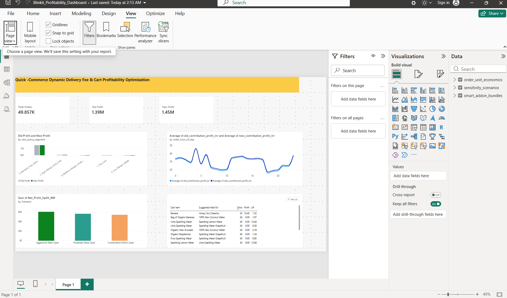

# Quick-Commerce Dynamic Delivery Fee & Cart Profitability Optimization

## 1. Business Problem
In 10-minute quick commerce (Blinkit, Zepto, Swiggy Instamart), last-mile delivery and dark-store picking incur a high fixed cost per order (₹40 normal / ₹55 peak surge). A flat **₹199 Free-Delivery threshold** ignores **product category margins** and **peak-hour rider surge**, causing two major profit leaks:
- **Tiny Impulse Carts (< ₹99):** High fixed rider cost outweighs small item margins (94.6% of tiny carts lost money).
- **Low-Margin Staple Traps (₹200+ Milk, Bread, Oil):** Orders qualify for "Free Delivery" despite having only 6–8% gross margins, resulting in negative contribution profit.

## 2. Solution & Methodology
Using a **50,000-order random sample** from the Instacart dataset (`49,857` valid non-alcohol orders) combined with an explicit, transparent **Unit-Economics Assumptions model**:
1. **SQL Unit-Economics Audit (`run_profit_analysis.py`):** Computed order-level contribution margin (`Gross Margin + Delivery Fee - Rider Payout - Picking/Packing - 1.5% Payment Gateway Fee`) and classified carts into 5 ordered policy segments.
2. **Margin- & Time-Aware Dynamic Fee Policy:**
   - **Tiny Carts (< ₹99):** ₹35 delivery fee (up from ₹25) to cover last-mile cost.
   - **High-Margin Carts (≥ 25% margin):** Lowered Free-Delivery threshold to **₹149** (₹199 peak) to boost conversion on profitable personal care/specialty baskets.
   - **Low-Margin Staple Carts (< 12% margin):** Raised Free-Delivery threshold to **₹249** (₹299 peak) with a ₹15 handling fee—waived when adding a recommended high-margin snack/beverage.
3. **Apriori Market Basket Add-On Engine (`market_basket_addons.py`):** Mined frequent itemsets (`mlxtend`) filtered specifically for **₹30–₹80 high-margin add-ons (≥ 18% margin)** with **Lift up to 13.84x** to push borderline carts into profitability.
4. **Sensitivity & Retention LTV Modeling (`build_dashboard.py`):** Stress-tested net profit uplift across Conservative (20% cancel, 8% 30-day churn), Moderate (10% cancel, 4% churn), and Aggressive (5% cancel, 1% churn) scenarios.

## 3. Key Results (50,000-Order Sample)
- **Loss-Making Orders Reduced:** Cut from **42.4% to 38.8%** across all orders (and cut tiny-cart losses by **44%**).
- **Direct Policy Profit Uplift:** **+₹58,795** (`₹1.39M` → `₹1.45M` total contribution profit).
- **Sensitivity-Tested Net Uplift:** **+₹56,367** in the Moderate base case and **+₹54,300** even in the Conservative worst-case scenario (after accounting for immediate cancellations and 30-day customer retention LTV loss).

## 4. Tech Stack
- **SQL (SQLite):** CTEs, multi-table joins, value-weighted cart margins, and ordered `CASE WHEN` policy segmentation.
- **Python (`pandas`, `mlxtend`, `matplotlib`):** Chunked ETL sampling, Apriori association rule mining, sensitivity simulation, and visualization.
- **Power BI:** Interactive cross-filtering dashboard across policy segments, dayparts, and sensitivity scenarios.

